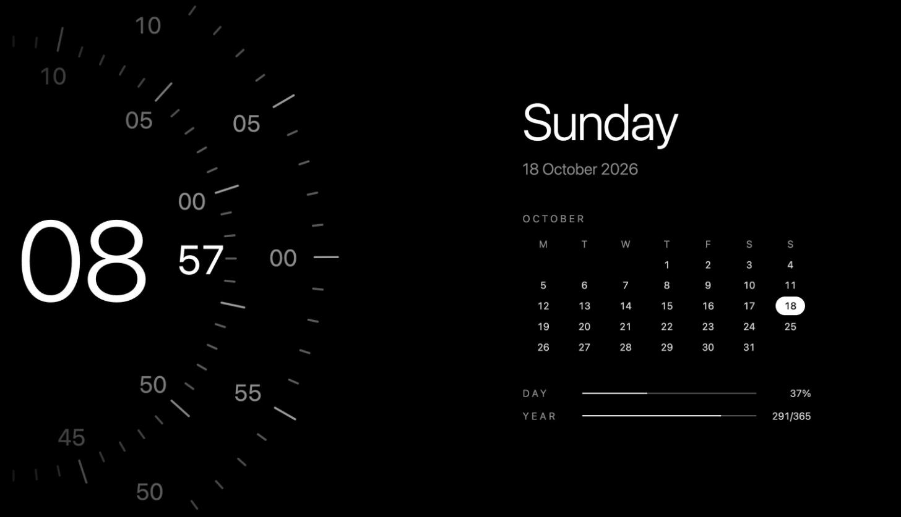

# LG TV Screensaver

Custom concentric clock screensaver for rooted LG webOS TVs. Replaces the stock screensaver with an animated clock panel showing time, date, calendar, and year progress.



## Features

- **Concentric clock dials** — hours, minutes, seconds with animated tick marks
- **Large digital time** — hours and minutes displayed prominently
- **Calendar panel** — full month view with today highlighted
- **Day/year progress bars** — percentage of day elapsed and day-of-year count
- **Auto-replacement** — watcher daemon detects the stock screensaver and swaps it out
- **Pure HTML/CSS/JS** — no dependencies, served via a tiny Node.js HTTP server

## How it works

Two components run at boot:

1. **HTTP server** (port 7777) — serves the screensaver HTML/CSS/JS files
2. **Watcher daemon** (`watcher.js`) — polls `getForegroundAppInfo` every 3 seconds. When the stock screensaver (`com.webos.app.screensaver`) or input overlay (`com.webos.app.inputcommon`) is detected in the foreground, it launches the custom screensaver app to replace it.

## Install

### From IPK

Build the IPK and install it on the TV:

```sh
./build-ipk.sh
scp com.custom.screensaver_1.0.0.ipk root@<TV_IP>:/tmp/
ssh root@<TV_IP> 'cd / && ar x /tmp/com.custom.screensaver_1.0.0.ipk data.tar.gz && tar xzf /data.tar.gz -C / && rm /data.tar.gz'
```

### Manual

```sh
# Copy screensaver files to TV
scp index.html clock.js style.css watcher.js root@<TV_IP>:/media/developer/screensaver/

# Install as webOS app
ssh root@<TV_IP> 'mkdir -p /media/developer/apps/usr/palm/applications/com.custom.screensaver'
scp appinfo.json index.html clock.js style.css icon.png root@<TV_IP>:/media/developer/apps/usr/palm/applications/com.custom.screensaver/
```

## Auto-start

The init script is part of the [webos5](https://github.com/i5dr0id/webos5) setup repo. It starts the HTTP server, the watcher daemon, and the USB file browser server together.

## Layout

```
index.html     Web page loaded by the screensaver app
clock.js       Concentric clock animation and calendar rendering
style.css      Dark theme styling for TV display
watcher.js     Node.js daemon that replaces the stock screensaver
appinfo.json   webOS app manifest
icon.png       App icon (80x80)
build-ipk.sh   Builds the .ipk package
```

## Related

- [webos5](https://github.com/i5dr0id/webos5) — Full TV setup with init scripts
- [webos-dlna-server](https://github.com/i5dr0id/webos-dlna-server) — DLNA media server
- [webos-usb-browser](https://github.com/i5dr0id/webos-usb-browser) — USB file browser
- [lg-remote](https://github.com/i5dr0id/lg-remote) — macOS remote control

## License

MIT
